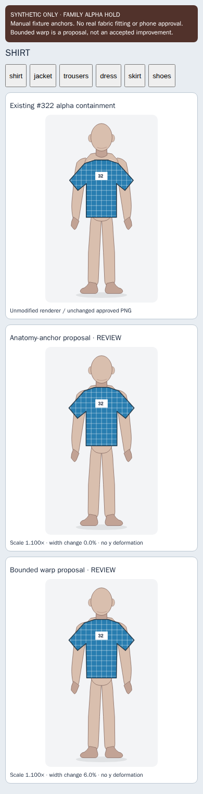
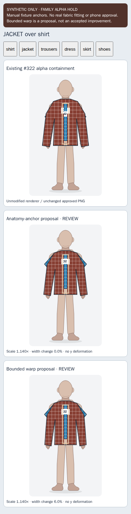
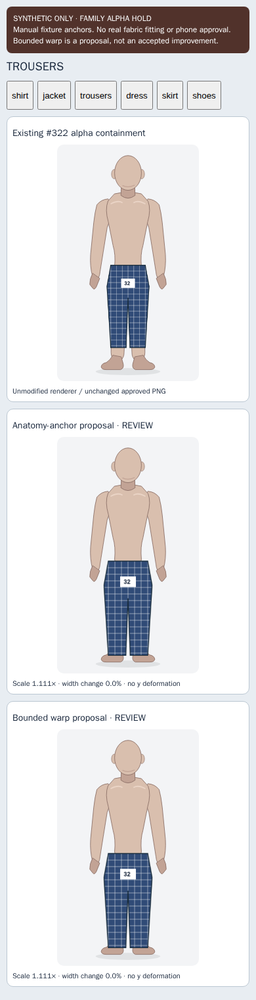
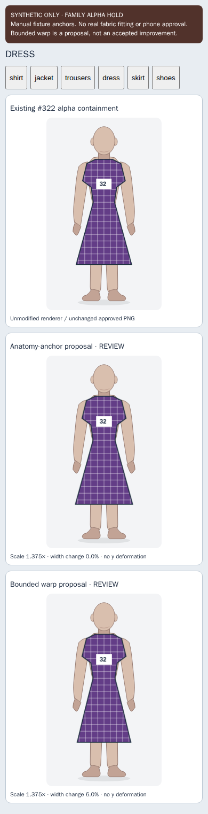
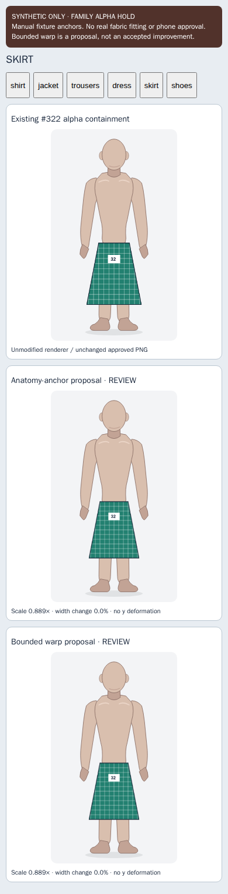
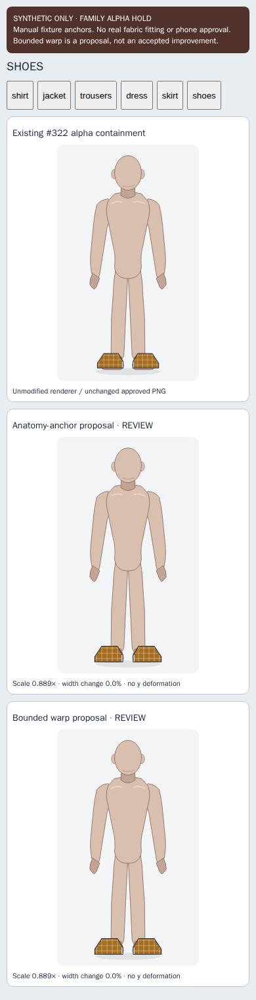

# Work 32 — anatomy-aware 2D fitting research, HOLD

## Decision after viewing the comparisons

**Keep rigid anchor alignment as an opt-in research proposal. Do not adopt the bounded warp as a default.** The screenshots show an alignment change, not consistently better clothing. The photographed-clothing realism milestone remains blocked: this experiment uses original code-generated synthetic fixtures, not approved licensed photographic cutouts. No family/customer photos used.

## Inputs and isolation

New branch `research/family-alpha-32-fitting` is based on #323 `cadb7f413475d746c0eb0d1848426546a758508a`, which includes #322 `68bed0c0f0f25538d0d5a00fbaf9aa34d80b8663` and #320 `094896d1b0655662787a78bc80d61af822a9e265`. Only new research, tests, evidence, documentation and no-deploy CI files are added. Existing humanoid artwork/renderer, clipping, recognition, styling and provider settings are untouched. #30 clipping and #31 styling integration are not imported or duplicated.

## Three alternatives

1. Existing #322 renderer: actual `renderPhotoLayers`, including alpha-bounds containment, on the unchanged articulated figure. This is stronger than an obsolete rectangle-only straw baseline.
2. Rigid anatomy alignment: a human-reviewed horizontal anchor pair maps to shoulder points, waistband or shoe centers using a single uniform scale/translation. No rotation or anisotropic stretch. Scale range 0.65–1.5; a source extending outside the 360×600 frame requires review.
3. Bounded deformation proposal: move source scanlines horizontally by a small amount below a protected chest/logo band. Width change ≤8%; local singular values 0.90–1.10 bound stretch/shear. Tests cover both expansion and contraction and reject frame clipping. Visible comparison uses 6% taper on shirt, jacket and dress; trousers, skirt and shoes intentionally remain rigid (0%). No invented fabric, texture, limbs, logo, replacement garment or pixel inpainting. Canvas interpolation may alter *derived raster* pixels; original PNG/JPEG bytes are never rewritten. Mathematical bounds do not prove visual fidelity.

## Visual review — six Chromium 390px comparisons inspected directly

Each screenshot is one genuine mobile browser capture: existing containment, rigid proposal, bounded proposal stacked vertically with the same figure/source. The 320/430 and WebKit captures are additional inspection material; they are not separately claimed to have received a full aesthetic review.

| Garment | Existing containment | Anchor proposal | Deformation / judgment |
|---|---|---|---|
| Shirt | Neckline sits below shoulders; hem is low and boxy | Raises neckline/hem; shoulders still expose skin; sleeve directions remain flat | 6% taper is subtle; no demonstrated realism gain; review only |
| Jacket over shirt | Broad rectangular torso and cuffs at hands; sleeves are visibly bulky | Jacket remains oversized; blue shirt corners protrude at both shoulders; cuffs still do not follow arm contour | Taper does not fix sleeve pose or overlap. **Do not approve as realistic** |
| Trousers | Hem ends above ankles, looking cropped | Longer silhouette reaches feet; waistband moves up; legs remain straight/boxy | Rigid only. Better length against this annotation, not proof of correct real trouser fit |
| Dress | Already roughly aligned to neckline and knee region | Nearly unchanged silhouette and length | 6% taper slightly narrows skirt; no clear benefit; keep original option |
| Skirt | Waistband low on hips | Waist raised and skirt narrower; length changes through uniform scale | Rigid only. Style/size preservation unresolved; no independent waist-to-hem fit |
| Shoes | Pair appears blocky over feet | Pair moves up; foot silhouettes remain visible below/to sides | No separate left/right pose correction; rigid pair cannot solve different shoe angles |

Grid/check pattern and `32` patch remain recognizable in the observed images. Logo band is outside the warp interval. This does not certify colorimetry, small logos or fabric details on real garments. Clean synthetic transparency has no background contamination by construction; background removal quality is **unmeasured**, not improved. No clipping algorithm is changed.

## Anatomical limitations

Shoulder and waistband anchors control scale/position, not body measurements. Chest/waist taper is a limited hypothesis. Shirt/jacket cuffs cannot follow the elbows/wrists without additional reviewed sleeve landmarks and a pose-compatible mesh. Dividing sleeves into independently bent pieces risks seams and pattern damage and was not implemented. Trouser inseam/knees, skirt hem and dress length need independent reviewed landmarks; uniform scaling couples width and length. Left/right shoes require separate approved components and reviewed ankle/toe anchors; this experiment keeps the pair intact. Automatic anatomical inference, 3D projection, drape and fitting realism are not claimed.

## Approved-photo/account contract

`approved-fit.mjs` requires current owner, private database name and session generation; matching item identity, original JPEG SHA-256 and region-review context; approved/human-confirmed/pixel-audited PNG; and reviewed annotations bound to owner, item, original source and exact PNG-string SHA-256. Foreign/stale/deleted/replaced sources reject. Async hashing rechecks source/session before display. An abort or `closet:alpha-session-changed` clears pixels. A per-container token prevents older pending fits overwriting newer requests. Caller remains responsible for authorized private snapshot access and upstream pixel audit; local hashes are not proof of Auth/RLS. No data is fetched or persisted by the fitting module.

A rejected fit returns `displayed:false` and `approved-preview` instructions without drawing. Caller must retain/show its separately approved original preview or request review. Excessive warp requests fall back to rigid, with an explicit reason. The research UI labels both proposals REVIEW. Nothing is automatically promoted to production or saved as approved clothing.

## Validation and reproduction

Run `node --test tests/research32/*.test.mjs` then `node scripts/test-family-alpha-32-browser.mjs` with Playwright 1.56.1 in the existing pinned browser container; see `.github/workflows/family-alpha-32-offline.yml`. Local browser execution is blocked by absent runtime executables. CI executes real Chromium/WebKit, canvas/PNG/JPEG decoding and the existing renderer. Synthetic metadata/approval flags are explicitly fixture-only, not human approval of a real photo.

Local pure geometry/scope tests: 10/10 PASS. Includes exact anchor mapping, logo-band protection, every-row factors, expansion/contraction shear limits, invalid dimensions/rotated/unreviewed anchors, overscale, frame clipping, unchanged inputs, wrong source/owner/PNG binding, async session change, event logout, abort and review-required fallback. Full browser matrix: 6 garments × 3 widths × 2 engines = 36 comparison pages; each page has 3 modes. Browser checks source strings, ownership/provenance rejection, cleanup, anatomical SVG, distortion bounds, no horizontal overflow, no page errors and zero external requests. Final CI evidence recorded below after completion.

## Release boundary

No merge, deployment, staging/production/provider change, paid AI/spending or Drive Duel work. Family Alpha HOLD. Main conversation retains final avatar appearance and release decisions. The next realism task needs an appropriately licensed, human-approved photo-cutout cohort with reviewed body landmarks, then real visual acceptance. Passing this synthetic experiment cannot close that gate.

## Final evidence

Tested source: `80927e178552c2cd4d8e3b8bac462162ef2608c6`.
[Research CI 40447255997](https://github.com/nickhaney916-lang/Closet-Current/actions/runs/40447255997) **SUCCESS**: 10/10 Node and 36/36 Chromium/WebKit comparison pages; zero external requests/page errors. [All 36 screenshots artifact](https://github.com/nickhaney916-lang/Closet-Current/actions/runs/40447255997/artifacts/12708802559). Camera/indexing inherited suite also SUCCESS on the same revision. Unchanged existing 2D aspect/browser suite passed on initial source revision `355f15e4` (run 40446891074). Later changes to this PR only add evidence/report files.

Mean existing containment anchor errors at Chromium 390, in **360×600 model coordinates**: shirt 15.36, jacket 6.61, trousers 11.00, dress 3.43, skirt 8.82, shoes 3.70 pixels. Rigid alignment maps the selected pair exactly by construction; that is *not* an independent quality score. Scale factors respectively 1.100, 1.140, 1.111, 1.375, 0.889, 0.889. Raw measurements for every browser/width are in [results.json](results.json). Logo checks address geometry/source identity, not photometric pixel equality after raster resampling.

### Directly inspectable mobile comparison captures

All six following final captures were inspected. Each has the same three alternatives, stacked in order, and explicitly marked SYNTHETIC/HOLD. They are captured at a 390px browser width; not physical-phone screenshots.

| Shirt | Jacket over shirt |
|---|---|
|  |  |

| Trousers | Dress |
|---|---|
|  |  |

| Skirt | Shoes |
|---|---|
|  |  |
