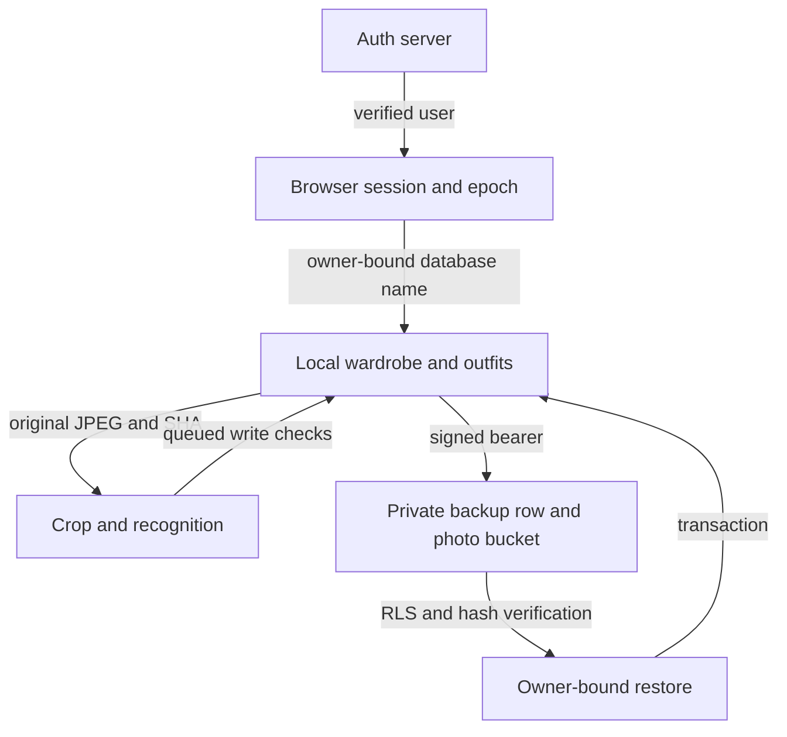

# SIGNED-OWNER-PRIVACY-25

Research only. Family Alpha #255 HOLD. Base PR #579 at `e104f2001f6ab993bd88481bd2257c83663ae93e`. PR #580 `abb5e3744725c7f3b08a71c73559ceae0f872e8f` is a sibling and stays separate.

## Authority and trust boundaries

| Layer | Authority and audit |
| --- | --- |
| Authentication | `public/auth.js` verifies email callback tokens with the Auth server and gets identity from password or refresh responses. Browser epoch is a stale-tab guard only. It is independent of server authorization. |
| Local wardrobe, drafts, outfits | `public/app.js` opens IndexedDB named after the server-returned user ID. IndexedDB is origin-wide, so application gating protects normal flows and does not defend against same-origin script compromise or DevTools access. |
| Original photos | Capture-proof and multi-garment research retain source identity. The cloud adapter uses owner/SHA paths and recomputes SHA before restore. Recognition crops are derived media. |
| Cloud records and objects | `supabase/cloud-backup.sql` enforces owner row and path policies using `auth.uid()`. The save RPC is security invoker and uses an expected-revision compare-and-swap. Cloud outfits and wardrobe are fields in the backup, rather than separately exposed tables. |
| Recovery | The atomic restore research verifies owner, validates references and originals, and writes in a transaction. The default cloud document schema and research export envelope are different layers. A copied arbitrary plaintext payload cannot be attributed to an owner by RLS alone. |

The pinned branch previously revoked browser state only after a logout request finished and reloaded only the active tab. A stale tab could hold the previous authenticated owner and DB connection. The fix invalidates local authority immediately, closes the connection and clears photos, camera and recognition work, rejects delayed refresh publication, and verifies the session before and after queued write preparation. Same-epoch token rotation does not lock another tab. Work that already committed before invalidation cannot be undone by logout. A storage change revokes app-level access, but a stolen bearer may remain valid until its signed expiry. A locked tab needs a reload before it can open another wardrobe.

## Evidence boundaries

The signed job starts an isolated disposable Supabase stack in CI, installs the unmodified repository SQL, and uses two real password sessions with signed tokens. The client refuses non-loopback destinations. Fixtures use synthetic marker JPEGs and no test credentials or signed URLs are emitted. A 200 response with no foreign rows is expected from RLS; the test rereads both original rows and photo hashes after attack attempts. The independent browser matrix runs actual app and IndexedDB with a fixture auth transport. It verifies a delayed write, logout in another tab, owner rotation and reopening the original owner data at 320/390/430. The inherited browser restore harness covers owner-bound restoration separately. The jobs do not establish signed browser-to-cloud end-to-end acceptance or access to any hosted environment.

## Donor heads audited

| PR | Exact head | Role |
| --- | --- | --- |
| 550 | `58d2178820b8a949cb49715696cfc977f79b72ef` | Auth research reference |
| 553 | `32e62ec4d85e460ed7da5b187d6823ce7cac6ce7` | Cloud RLS |
| 554 | `dbc344cc6809c23ab9215b1d7b08649687da17a6` | SQL-role two-owner prior evidence |
| 558 | `7201fce6a3e13c795877b30eb190f91e9106085a` | Atomic restore |
| 561 | `21189b56d9f9f6ce57ad9dc795b9fe222544862e` | Native indexing |
| 565 | `f3bf920ef95c35d2b990dd2a852c20d9a9f71c5e` | Owner correction CAS |
| 569 | `ca23c25d6621ea41c29fc9bac5f32eefb829b550` | Native multi-photo style |
| 574 | `9012e01443f97f81b236a4f51afdbb6ad885aaaa` | Release gate |

The branch uses only the PR #579 parent tree. Donor head inspection is not a merge or a statement that every donor is in default. Separate staging, cloud application integration, physical-device behavior, expired-token timing, and complete browser lifecycle coverage are release gaps.
